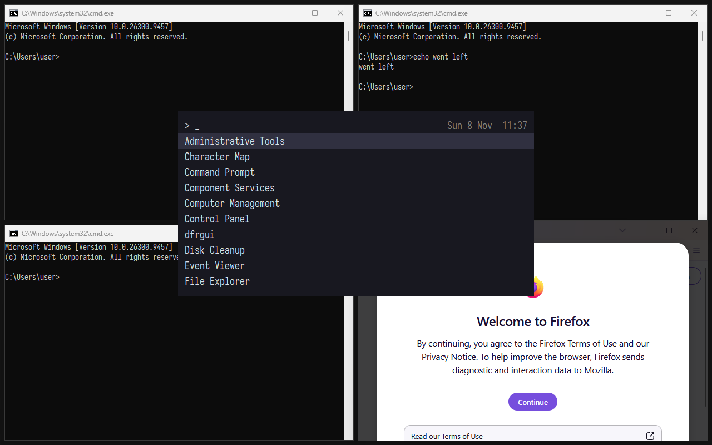

# defenestrate

A Windows distro, NixOS style: a flake that takes Microsoft's stock Windows 11
ISO and builds an install ISO with explorer.exe thrown out of the window and
the rest of Microsoft's opinions configured away.

Everything is declared in `configs/` as typed Nix options: edition, locale,
user, disk layout, replacement shell, and registry values per hive.



## Status

- [x] Stock ISO → single-edition install ISO (plain ISO9660, split WIM, so it fits a FAT32 stick), BIOS + UEFI boot
- [x] Registry config as typed Nix (`sz`, `expandSz`, `multiSz`, `dword`, `qword`, `binary`, delete), validated against the image's own hives at build time
- [x] Generated autounattend.xml: local account, no OOBE, no Microsoft account, optional disk wipe + autologon
- [x] QEMU test VM with Secure Boot and TPM 2.0
- [x] Verified install end to end in the VM: unattended setup, specialize registry import, OOBE, first-logon shell switch, our shell running with no explorer.exe
  - Fully hands-off offline (`restrict=on`): a headless run went from the ISO to our shell in ~47 minutes with no input. Online, OOBE's zero-day-patch check fails in the VM and waits for a "Skip" click. On real hardware: install offline, or hit "Try again".
- [x] Rust shell, cross-compiled in the flake (`nix build .#shell`): a tiling window manager with COSMIC's tiling and keybindings, and a Super-tap launcher over the Start Menu's shortcuts. Seen tiling, focusing, moving and launching in the VM; resize mode, workspaces, float and maximize are unit-tested only so far
  - Primary monitor only. Minimized windows drop out of the tiling and, with no taskbar, can't be brought back. Elevated windows and dialogs float, and while an elevated window has focus the shell's keys don't work (Windows doesn't give a non-elevated keyboard hook their input). A crashing shell leaves windows on other workspaces hidden
- [x] Iosevka Nerd Font Mono installed system-wide (`fonts`) and used by the shell and every console. Windows 11 hands consoles to Windows Terminal once it's registered, which ignores console fonts, so the default terminal is pinned to conhost
- [x] libcosmic builds for Windows from Linux (`nix build .#cosmic-bar-prototype`); not run on Windows yet
- [x] Declarative apps (`apps`, `wingetApps`, `storeApps`) pinned in `apps.lock.json` by `nix run .#lock-apps`; baked installers go into the image and install on the first real boot. Verified on saturn's image booted fresh in QEMU: Firefox (machine-wide, as SYSTEM) and Discord (per-user) installed with the shell's keys working throughout; League's installer asks for elevation
  - Not yet observed: the online `wingetApps`/`storeApps` path (the test VMs are offline). `wingetApps` installs a pinned version, which fails once winget-pkgs drops it; store apps get whatever is current. Baked apps that are bootstrappers (Steam, League's Riot Client) still download the real thing at runtime.
- [ ] Shell: system tray, notifications, multiple monitors, COSMIC's stacking and swap mode
- [ ] Provisioned AppX removal (Outlook, Teams, Copilot, …)
- [ ] WSL2 with a nix-built kernel and NixOS-WSL, mounting the Linux drives
- [x] Whole-disk image built in the nix sandbox (`build.image`) and flashed from Linux with no boot media (`build.install`), replacing nixconf's `saturn-windows-image.sh`. Flash-and-boot verified on a disk-sized file, and booted to the shell on real hardware

## Usage

Download the Windows 11 ISO named in `nix/source.nix` from
<https://www.microsoft.com/software-download/windows11> and add it to the store
once:

```sh
nix-store --add-root ./windows-iso.gcroot -r \
  "$(nix-store --add-fixed sha256 Windows11_Client_x64_en-us_26300_9457.iso)"
```

The GC root matters: nothing else references the ISO, so the next
`nix-collect-garbage` would delete it.

Then:

```sh
nix build .#vm-iso   # ISO for the test VM: wipes disk 0, logs straight in
nix run .#vm         # boot it in QEMU; state lives in ./.vm
```

A full install in the VM takes about an hour on a loaded 8-core desktop
with the VM disk on an HDD. Shell logs go to `%LOCALAPPDATA%\defenestrate\shell.log`.

The build needs ~25 GB of scratch space and takes a few minutes, mostly
spent exporting the edition out of the 8 GB `install.wim`.

For real hardware, build a config with `lib.x86_64-linux.mkDistro [ ./configs/default.nix ./my-machine.nix ]`.
It must set `user.name` and should leave `disk` at the default `interactive`.

### Installing onto a disk without a USB stick

`build.image` is a whole-disk image built in the nix sandbox: the whole
unattended install (setup, specialize, OOBE, first logon's shell switch)
runs in the VM above (KVM, `requiredSystemFeatures = [ "kvm" ]`) against a
64 GiB scratch disk, offline, and first logon powers the VM off instead of
rebooting. The build then checks Windows Boot Manager is on the image's ESP
and reads first logon's log straight off NTFS with sleuthkit, which also
proves BitLocker didn't touch C:. Progress goes to the build log; a 20
minute stall or 3 hours fails the build and leaves screenshots in the build
dir for `--keep-failed`. ~10 minutes on an idle desktop; 65–75 on one shared with other heavy jobs. The disk is NVMe, so the
image boots on a real NVMe controller through the same inbox driver, no
sysprep.

`build.install` flashes it, like an SD card image:

```sh
nix run .#…build.install                         # erases installTarget
nix run .#…build.install -- /dev/disk/by-id/nvme-…   # or any whole disk, by-id
```

It refuses a disk that isn't addressed by-id, a partition, anything smaller
than the image, and anything with a mounted filesystem, a member of a
mounted multi-device filesystem, or an md/LVM/dm holder. Then it re-runs
itself under sudo, asks you to type `ERASE`, discards the disk, writes the
image, moves the backup GPT to the disk's end and grows Windows (the last
partition, resized in place so the partition GUID the BCD boots by stays)
with `ntfsresize`. Last it adds a "Windows Boot Manager" firmware entry
without touching the boot order.

Windows takes the whole disk, its own ESP included. The first boot finds the
real hardware the way Windows does after a motherboard swap and comes up at
the shell: on a file the size of a 1 TB disk put through exactly these
steps, booted with fresh firmware variables and a fresh TPM, that took ~2
minutes with no setup screens. Network or not doesn't matter, OOBE already
ran offline in the sandbox.

### Apps

Apps are winget package IDs, pinned in `apps.lock.json` like an npm
lockfile:

```nix
apps = [ "Mozilla.Firefox" ];          # baked into the image, installed offline
wingetApps = [ "Valve.Steam" ];        # winget installs the locked version, online
storeApps = [ "9NKSQGP7F2NH" ];        # Microsoft Store product, online
```

```sh
nix run .#lock-apps -- Mozilla.Firefox            # lock (or re-resolve) a baked app
nix run .#lock-apps -- --winget Valve.Steam --msstore 9NKSQGP7F2NH
nix run .#lock-apps -- --bump                     # newest winget-pkgs, relock everything
```

`lock-apps` resolves each ID against the winget-pkgs commit recorded in the
lock, picks the installer winget would (x64, en-US, machine scope first),
and records its URL, hash, type and silent switches. Manifests without
switches get their type's standard ones (msi `/qn`, nullsoft `/S`, inno
`/VERYSILENT …`, burn `/quiet`). It downloads every baked installer once and
checks it against the manifest's hash, so a URL whose contents have moved on
fails at lock time; the download stays in the store for the build.

Unknown IDs, msix/zip/portable-only packages, and exe installers with no
silent mode fail at lock time. An ID that isn't locked, or is locked as a
different kind than the config says, fails evaluation with the command that
fixes it.

The build `fetchurl`s every baked installer into the image under
`C:\Windows\Setup\defenestrate\apps`. The image's first logon (in the
sandbox) registers two scheduled tasks that run at the user's next logon,
the machine's first real boot, next to the shell rather than in front of it:

- As SYSTEM, in session 0: machine-wide installers. Logs to
  `C:\Windows\Setup\defenestrate\apps.log`. Not elevated in the user's
  session, because the shell's keyboard hook gets no keys while an elevated
  window has focus, and the installers held it.
- As the plain user: per-user installers (the lock records each installer's
  scope), which break when elevated, then winget/store apps, retrying for up
  to an hour while winget registers and the network comes up. Logs to
  `%LOCALAPPDATA%\defenestrate\apps.log`.

Each reruns at the next logon if anything failed and deletes itself once its
apps are in.

Some per-user installers ask for elevation themselves: League of Legends'
Riot installer shows a UAC prompt on the first boot, and clicking No (or
nothing, until it times out) leaves it for the next logon. Discord asks for
its "System Helper" on its own first launch.

### Keys

COSMIC's defaults (`cosmic-comp`'s `data/keybindings.ron`), where the shell
has the feature:

| Keys | Does |
| --- | --- |
| Super (tap), Super+/, Super+A | Launcher: type to filter, Enter starts it, or runs the text as a command if nothing matches |
| Super+H/J/K/L or arrows | Focus left/down/up/right |
| Super+Shift+direction | Move the window |
| Super+Ctrl+direction | Previous/next workspace (with Shift: take the window along) |
| Super+1–9, Super+Shift+1–9 | Switch to / send the window to a workspace |
| Super+O | Flip the split the window is in |
| Super+M, Super+G, Super+Y | Maximize, float the window, tiling off for the workspace |
| Super+R (Super+Shift+R) | Resize mode: directions grow (shrink) that edge, Enter/Escape leave |
| Super+Q | Close |
| Super+T, Super+Enter | Terminal |
| Super+F | Home folder |
| Super+Escape, Super+Shift+Escape | Lock, log out |

Win+L would lock the session before the shell could see it, so the
default config sets `DisableLockWorkstation`. That blocks `LockWorkStation()`
too, so Super+Escape locks by disconnecting the session (`tsdiscon`), which
shows the same lock screen and reconnects to the same session on sign-in.

## How it works

1. 7-Zip unpacks the ISO. Microsoft's ISO is UDF-only, so xorriso can't read it.
2. wimlib exports the one edition we want from `install.wim`.
3. Each hive's `.reg` file is merged into a scratch copy of that hive with
   hivex. This is only a check: a malformed `.reg` fails the build instead
   of a VM install.
4. The `.reg` files and `specialize.cmd` are added to the image under
   `C:\Windows\Setup\defenestrate`, and the shell under
   `C:\Program Files\defenestrate`. During the specialize pass, Windows runs
   `reg import` on them itself. The shell switch is the exception: it runs on
   the first real logon and then reboots, because OOBE's own temporary
   session needs explorer and falls over without it.
5. `boot.wim` gets the answer file and a `winpeshl.ini` that forces legacy
   setup, because the 24H2+ setup drops the specialize/oobeSystem passes.
6. `install.wim` is split into `install.swm` parts under 4 GiB and xorriso
   writes a plain ISO9660 image. The single-edition image is 7.5 GB, and the
   first attempt (one big file in a UDF image from cdrtools' mkisofs) left
   Windows setup stuck at 0% without ever reading past the file's start.

Why the registry isn't edited offline: when wimlib replaces an existing file
from Linux, the file loses its NTFS security descriptor and gets its parent's
inherited ACL. For registry hives that's a HiveNightmare-style bug, so Windows
applies the edits instead.
