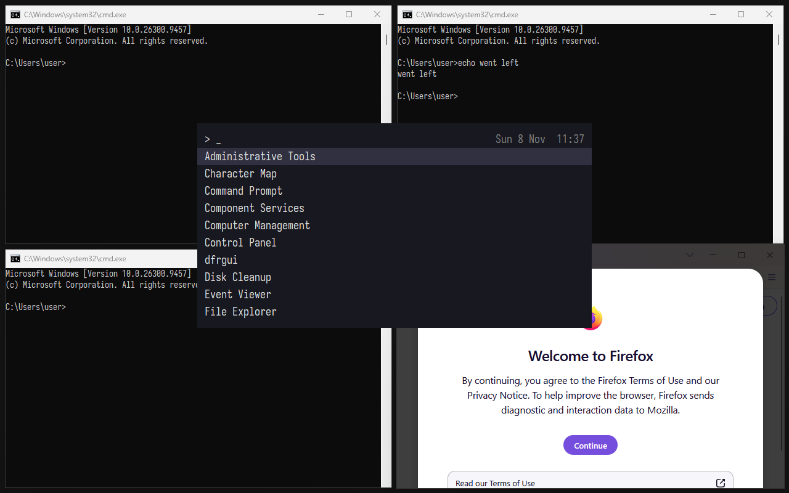

# defenestrate

A Windows distro, NixOS style: takes Microsoft's stock Windows 11 ISO and
builds an install with explorer.exe thrown out of the window and the rest of
Microsoft's opinions configured away.

Two halves:

- **`dfnstrate`** (`cli/`), the Linux side: fetches the stock ISO, builds an
  install ISO or a finished whole-disk image from a config, flashes it, and
  sets up WSL to run the machine's Linux install. A plain Rust binary; it works on any distro. The Nix flake is a
  thin layer that runs the same commands, so both paths hit the same code.
- **The shell** (`shell/`), the Windows side: a tiling window manager that
  replaces explorer.

A config is TOML (or a Nix module setting the same keys): edition, locale,
user, disk layout, shell, fonts, the Linux install to reach through WSL, AppX packages to drop, and registry
values per hive. Every config is layered over the distro's own defaults,
[`configs/default.toml`](configs/default.toml).



## Status

- [x] Stock ISO → single-edition install ISO (plain ISO9660, split WIM, so it fits a FAT32 stick), BIOS + UEFI boot
- [x] `dfnstrate`: one Rust CLI for fetch/build/flash, layered TOML configs, a hash-addressed download cache. The flake's ISO, image, VM and install outputs run it, with the cache filled by fixed-output derivations, so a non-Nix build runs the same code as the Nix one
  - Seen: the Nix and non-Nix ISOs for the VM config have identical contents (every file and all 187k `install.wim` entries; only timestamps and the shell exe differ, the latter because rustc puts random temp dir names in its import libraries). A non-Nix `build image` booted to the shell like a fresh machine. `flash` is ported line for line from the old install script but hasn't been run onto a disk since
- [x] Stock ISO fetched by driving microsoft.com's download page in headless Chromium (`dfnstrate fetch`); the page's API rejects plain HTTP clients
- [x] Registry config as typed values (`sz`, `expandSz`, `multiSz`, `dword`, `qword`, `binary`, `"delete"`), validated against the image's own hives at build time
- [x] Generated autounattend.xml: local account, no OOBE, no Microsoft account, optional disk wipe + autologon
- [x] QEMU test VM with Secure Boot and TPM 2.0
- [x] Verified install end to end in the VM: unattended setup, specialize registry import, OOBE, first-logon shell switch, our shell running with no explorer.exe
  - Fully hands-off offline (`restrict=on`): a headless run went from the ISO to our shell in ~47 minutes with no input. Online, OOBE's zero-day-patch check fails in the VM and waits for a "Skip" click. On real hardware: install offline, or hit "Try again".
- [x] Rust shell, cross-compiled in the flake (`nix build .#shell`): a tiling window manager with COSMIC's tiling tree, keybindings and Super+drag, gapless and without title bars on tiles, a Super-tap launcher over the Start Menu's shortcuts, and COSMIC's Alt+Tab window switcher. Seen in the VM: tiling, focusing, moving into thirds by keyboard and by Super+drag (with the drop preview), Super+right-drag resizing, floating and re-tiling (title bar back and gone again), a killed and restarted shell picking its tiles back up, and launching; resize mode, workspaces and maximize are unit-tested only so far
  - COSMIC's window animations (`shell/src/motion.rs`): tiling changes ease over 200 ms and queue behind a running one, new tiles fade in, ones leaving fade out, maximize grows out of the tile, unmaximize shrinks a fading copy over 320 ms, workspaces slide vertically. Drawn by a click-through overlay of DWM thumbnails while the real windows already sit in place; nothing when "Animation effects" is off or a fullscreen app has focus, and no timer or thread awake when nothing moves. Seen in the VM: open, swap, maximize, unmaximize, send to another workspace and both directions of a workspace switch, frame by frame, and 0–47 ms of shell CPU over 1–2 idle minutes. The VM composites in software at about 5–8 frames per animation, so smoothness on real hardware isn't seen yet; the fullscreen and "Animation effects" checks are untested
  - Window switcher (Alt+Tab, Super+Tab), as cosmic-launcher's alt-tab view: every window on every workspace, minimized ones included, most recently focused first; letting go of the modifiers goes to the selection's workspace, restores and focuses it. Without explorer, Windows' own Alt+Tab still switches but shows nothing and can't reach other workspaces, so the shell takes the keys. Seen in the VM: switching among three windows (five times running), Shift going backwards, Escape cancelling, and bringing back a window minimized on another workspace, onto its workspace and back into the tiling. Windows the shell doesn't tile (games in exclusive fullscreen, and elevated apps when it runs without uiAccess) are listed too, untested. A restored tile splits the focused window instead of going back to its old spot, as COSMIC's would
  - Multiple monitors, as COSMIC's default "workspaces per display": each monitor has its own nine workspaces and switches them by itself; new windows, Super+1–9, the launcher and the switcher go by the monitor the pointer is on, moving windows by the one with focus. Focus past the left or right edge of a monitor's tiling goes to the next monitor (the pointer goes along), and a window moved past it goes there too, taking the half of the layout it came in on; past the top or bottom, the previous or next workspace. A tile Super+dragged onto another monitor drops into that one's tiling. An unplugged monitor's workspaces go to the first monitor, into free slots, and back to their own slots when it's plugged in again. Overlays and Super+drag sizes follow each monitor's DPI. Seen in the VM with two monitors (std VGA plus virtio-gpu with virtio-win's viogpudo, since Windows' inbox driver drives only one): tiling on each in its own area, Super+Alt+Right moving the pointer and new windows to the second, focus coming back with Super+Left, Super+1/2 switching one monitor's workspace with the other left alone, Super+Shift+Right carrying a window across onto the near half and Super+Shift+Alt+Left bringing it back, the launcher opening on the pointer's monitor, and a monitor switched off and on again (`DisplaySwitch /internal`, `/extend`), its workspace landing in a free slot on the other and going home after. Unit-tested only: Super+drag between monitors, mixed DPI (the VM's two are the same), floating windows keeping their place across, and unplugging real hardware
  - COSMIC's settings from the config, under cosmic-comp's names ([Shell settings](#shell-settings)): gaps, the active hint (a 1 px accent border just outside the focused window, a click-through window of the shell's own, moved only when focus or a tile changes), focus following the pointer after a delay, the pointer following keyboard focus, windows on other workspaces raising themselves left there, autotile, and custom shortcuts over COSMIC's defaults. Seen in the VM: the hint around the focused tile in the 1 px edge gap and on the seam between two tiles, which have no gap between them; Super+T and Super+D running the terminal and the launcher; Super+Y and Super+F doing nothing in the shell (the letter reaches the focused app, as any unbound Super+letter does without explorer); focus following the pointer, with a pass over a tile shorter than the delay changing nothing (the hint moved 260–300 ms after the pointer against 100–140 ms after a key, in a loaded VM drawing 5–8 frames a second); the pointer jumping to a new window and to one focused with Super+L. Windows' own Win+V (clipboard history) and Win+. (emoji panel) don't open without explorer. Neither does the PrintScreen snip overlay: on saturn (2026-11-26) the key only copied the whole screen, silently. The shell now takes PrintScreen and Super+Shift+S and opens the overlay itself; untested on Windows, including whether `ms-screenclip:` works without explorer or the `SnippingTool.exe /clip` fallback is what opens it (`shell.log` says which). The activation policy and media keys are unit-tested or untested only; gaps and the hint are sized by the primary monitor's DPI on every monitor
  - A minimized window leaves the tiling but stays on its workspace; where no tile covers it, Windows still draws its stub of title bar in the bottom-left corner. Dialogs float: windows that are owned, tool windows, always on top (splash screens), or neither sizable nor minimizable, and so do the ghosts Windows puts up for hung windows. Fixed-size and self-drawn app windows (launchers, installers, League's client) tile, since a minimize box is what sets them apart from a dialog; `cosmic.window_rules` floats the ones that still shouldn't, and `shell.log` has a line per new window saying which it got and why. Ones that won't take their tile's size are letterboxed in it at their own size ([Keys](#keys) has how they're told apart). 5780fa8's first version was seen failing on saturn (2026-11-26): it judged a window without `WS_THICKFRAME` fixed-size before asking it anything, and since the shell takes that bit away itself with the title bar, ordinary windows were latched at the size they had (a console stayed a quarter tile wide after its tile grew); League's game, latched at 2576x1440 in a 2560x1440 tile, sat 9 px over its neighbour and 7 px off the screen. Now every window is asked for its tile first, a refusal is dropped when the tile's size or the app's style changes, and a window bigger than its tile is kept on its monitor. Unit-tested (the console's style flicker and its tile growing, League's 2576 in a 2560 tile on a 5120 monitor, refusals, style changes, holding through focus changes, workspace switches and moves); the new version not seen on hardware yet, and a maximized one still animates out to the whole screen before it settles centred. Focus following the pointer holds while a game clips the cursor, and unowned dialogs stay above the tiles; unit-tested where pure (the clip rule), not seen on Windows yet. Elevated windows tile and take the shell's keys and Super+drag like any other, through uiAccess ([Elevated windows](#elevated-windows)); if Windows won't grant it, they float and the keys don't reach them, as before. A crashing shell leaves windows on other workspaces hidden
- [x] Iosevka Nerd Font Mono installed system-wide (`fonts`, fetched from the Nerd Fonts release) and used by the shell and every console. Windows 11 hands consoles to Windows Terminal once it's registered, which ignores console fonts, so the default terminal is pinned to conhost
- [ ] Shell: system tray, notifications, COSMIC's stacking and swap mode
- [x] Autostart without explorer: the Run keys, HKCU RunOnce and Startup folders as explorer runs them, Task Manager's toggles honoured, once per logon, then the config's `autostart` lines. Unit-tested only (the toggle bytes, RunOnce prefixes); not run on Windows yet
- [x] Provisioned AppX removal (`appx.remove`): deprovisioned during specialize, names checked against the image at build time. All 17 in the defaults removed in a `build image` run (from `specialize.log` on the image)
- [x] No automatic Windows updates (`NoAutoUpdate` policy): an install is rebuilt and reflashed, not patched in place. Not seen yet: Windows leaving the policy alone over weeks
- [x] No automatic driver downloads either (PnP's Device Driver Retrieval Client ignores `NoAutoUpdate`; blocked with `ExcludeWUDriversInQualityUpdate`, `PreventDeviceMetadataFromNetwork` and `DriverSearching`, lifted only for the display-driver pass). Seen on saturn (2026-11-20): no Device Driver Retrieval Client installs, no RebootRequired, and the display-driver pass still ran
- [ ] Default apps (`defaultApps`: extension or URL scheme -> ProgId), by asking: Windows 11 keeps the default the user's own choice (UserChoice is hashed and UCPD.sys guards it), and the DefaultAssociationsConfiguration policy did nothing on saturn, which isn't domain-joined (two sign-ins, https still Edge). At each logon, while one isn't set and the app registering its ProgId is installed, the shell opens Settings at that app's default-apps page once (`ms-settings:defaultapps?registeredAppMachine=`), for one click on "Set default". Not seen on hardware yet
- [x] Updates baked into the image ([Windows updates](#windows-updates)): the newest cumulative update, tracked in the Update Catalog, added by DISM in setup's WinPE before Windows first starts. Seen in a `build image` run for saturn: KB5132061 (4.7 GB) went in, and the image's SOFTWARE hive says 26300.9974 against the ISO's 9457; the whole VM run took 15 minutes. The image grew from 35 to 42 GB compressed, since the update's superseded components stay in WinSxS
- [ ] Pointer speed and key repeat from COSMIC's (`cosmic.compositor.input_default`, `xkb_config`, `displayScale`): libinput's flat multiplier as a straight Enhance-pointer-precision curve that Windows' own 16.16 arithmetic turns into the same multiplier, and the nearest Windows repeat steps. Unit-tested against MarkC's 1-to-1 curves and every libinput speed at the scales Settings offers; the pixels-per-count ratio against Linux's not measured on hardware yet. `update` carries a change through the boot queue, which puts it into effect at that logon where Windows has a SystemParametersInfo for it (not `displayScale`, which takes another logon)
- [x] Gaming defaults for the new user: mouse acceleration ("Enhance pointer precision") off, and the Sticky/Filter/Toggle Keys hotkeys that pop a dialog over the game off. Seen in the user's hive after a fresh `build image` booted in the VM: MouseSpeed/MouseThreshold1/MouseThreshold2 0/0/0, StickyKeys 506, Keyboard Response 122, ToggleKeys 58
- [x] Windows apps (`apps`): winget IDs, unpinned, installed by winget at the first real boot from a logon task first logon registers. Seen in the VM under our shell, online: the script installed Firefox elevated, and an equivalent logon task fired at the next logon, installed 7-Zip and deleted itself. From a fresh `build image`: first logon registered the task, and it ran at the first real boot and removed itself (the VM config has no apps, so only the GPU pass below ran)
  - Pinned drivers (`drivers`): .cabs from the Update Catalog (or any archive 7-Zip opens), added to the image and installed by pnputil at specialize. Seen in a `build image` for saturn: specialize added AMD's three packages to the driver store and removed the staged copy (pnputil exit 3010, "reboot to finish"). Binding to a real GPU not seen yet
- [x] Tracked downloads and `dfnstrate pins` ([Pins](#pins)): GitHub release assets and Update Catalog drivers, resolved at build time without Nix, pinned in place for Nix. Run against the live catalog (it found the .cab pinned by hand) and GitHub (moved an unpinned font to the hash the defaults already had, comments kept); a `render` with an unpinned font downloaded it online and refused with `--offline`
  - GPU drivers (`gpu`): a Windows Update pass for display drivers at first boot; winget has none to offer. Seen from a fresh `build image` in the VM, online: the pass found QEMU's VGA (vendor 1234), asked Windows Update, which had no display driver for it, and finished in 6 minutes. Not yet seen on real GPU hardware
- [ ] WSL installed offline, and the machine's Linux install run through it (`wsl.linux`): its disks attached and mounted, its programs run chrooted as its user from a "Linux terminal" in the Start Menu
  - Files and secrets from the install copied into the Windows profile at logon (`wsl.linux.files`): `dfn pack` is in the flake check (a store symlink resolved, a group-only secret read), and the copy step ran under pwsh on Linux against a fake `wsl.exe` (bytes intact, directories replaced, a missing source failing alone). Not yet run on Windows
  - Seen in a VM (Windows nested in KVM, a saturn-shaped btrfs test install as a second disk, `nix build .#test-linux-disk`): WSL installs from the image, the logon task imports the distro, attaches the disk by GPT GUID, mounts it and puts the "Linux terminal" in the Start Menu, which opens the user's login shell from the install. dfn's half is also a flake check (`checks.x86_64-linux.dfn`)
  - Linux GUI windows are a non-goal. WSLg's viewer (msrdc) only connects while a real explorer runs as the shell: a dump of it under our shell shows its connection thread never starting, and faking explorer's documented surface (Shell_TrayWnd and its appbar/tray messages, the shell window, the shell-ready events, TaskbarCreated) doesn't change that. Running explorer hidden underneath works, but this Windows exists to be a console for kernel-anticheat games, so explorer stays out. The experiment is on branch `t3/wslg-windows-under-shell`
  - Terminal programs work: Start Menu → "Linux terminal" (`dfn shell`) opens the user's login shell from the install, as the user, in their home
- [x] Updating an install from Linux without a reflash (`dfnstrate update`, `build.update`): the shell, fonts and WSL payload are rewritten in place on the shut-down Windows partition, each keeping its NTFS security descriptor, and the logon task re-imports the distro when `rootfs.tar` changed. Registry config that changed goes onto the boot queue, below
- [x] The boot queue ([Boot queue](#boot-queue)): what Linux asks Windows to do once at its next boot, typed by phase (HKLM imports as SYSTEM at startup, HKCU imports as the user at logon), run once each by `boot.ps1` with a done marker per action, logged to `%ProgramData%\defenestrate\boot-*.log`. A build's image starts with the registry config on it, so the first boot runs the queue as every `update` will; `update` queues a hive's import only when its rendered .reg changed since the last one queued. Unit-tested (hashing and change detection, numbering and replacing, done markers, which phase each action gets, which values get a settings refresh); `checks.boot-queue` runs `update` against an NTFS image in a VM (created files inherit `C:\Windows\Setup\defenestrate`'s ACL, a second run queues nothing, a keyboard change queues only the user import) and then the runner on that queue under pwsh on Linux with Windows' calls faked (each action once and in order, a failure resuming where it stopped, the refreshes, refusals outside a phase's root or of a payload not matching its hash). Not run on Windows yet: `reg import` from the tasks, the ACL check, the SystemParametersInfo calls, and the registration from `linux-first.ps1` on an install from before the queue
- [x] Reading what the last Windows boot logged, from Linux (`dfnstrate logs --out DIR`, `build.logs`): defenestrate's logs (shell, wsl, apps, reboot, linux-first, setup) copied off the shut-down partition through a read-only ntfs-3g mount, plus any `--also` path under C:\\, owned by the caller rather than root. Checked in a VM (`checks.logs`) against an NTFS image; not yet on a real disk
- [x] Firefox survives a reflash, and the first install starts logged in ([Firefox across reflashes](#firefox-across-reflashes), `persist.firefox`): `flash` copies the old install's `%APPDATA%\Mozilla\Firefox` to a store on Linux before erasing it and writes it onto the new one before its first boot; with nothing kept yet, it seeds a new profile with a Linux browser's cookies, logins and containers. Unit-tested (which files go and come back, kept over seed over nothing, the seeded profiles.ini/installs.ini, container ids against cookies), and `checks.persist` runs save, restore and seed against NTFS images in a VM: the copy-off leaves the volume untouched, the restored files inherit the profile directory's ACL instead of Everyone: full control, compatibility.ini stays behind, a seed taken from a WAL database a browser hasn't checkpointed has every row, and a browser holding its database fails the seed before anything is written. Not run by `flash` onto a real disk, and not seen in a Windows Firefox yet: that it opens the restored or seeded profile and is still logged in is for a real boot
- [x] "Reboot to Linux" unmounts the Linux install inside WSL first (`dfn release`: flush, ask then make whatever uses it quit, unmount deepest first, read-only if something won't let go), then shuts WSL down. Without it, the last 30 s of what Windows wrote to the install were lost, since btrfs writes back every 30 s and the reboot killed WSL's VM with it mounted (seen on saturn: a report's last items and a rename, done and then missing on Linux). Checked in the dfn VM test; a plain Windows shutdown or a reboot from elsewhere still doesn't release it
  - Seen on a `build image` output booted in the VM: `update` rewrote `rootfs.tar` and `wsl-logon.ps1` with their descriptors unchanged; at the next logon the distro was re-imported with the new `dfn` and mounted the test install, which the image's older distro had failed to; the logon after that didn't re-import. The partition was reached through ntfs-3g in a user namespace, so the by-id disk route has only been run as far as its refusals (a mounted disk, a partition, a non-by-id path), not onto a real disk
- [x] `dfnstrate reboot`: into Windows once, by the firmware's BootNext, so the boot after it is Linux again. Picks the Windows Boot Manager entry whose ESP is on a disk that's attached, refuses to guess between two Windows (`--entry`); entries sharing an ESP count as one, `--no-reboot` only sets it. Seen in the VM on a `flash --into-free-space` disk: with dfnstrate's entry and Windows' own on one ESP it set BootNext without asking; not yet run on real hardware
- [x] `dfnstrate doctor`: a read-only preflight run as the user, one line per check with the fix: UEFI, Secure Boot (with a fix for the bootloader it finds: lanzaboote, systemd-boot, GRUB, shim), TPM 2.0, `/dev/kvm`, every command's tools and the OVMF, which Windows boot manager Secure Boot's db trusts, scratch and cache space, whether the work dir is on a spinning disk, Windows Boot Manager entries live or stale, an RTC on local time, and disk swap Linux could hibernate to. Exits non-zero on any failure. Parsing is unit-tested; run on one NixOS machine and in the free-space test VM so far
- [x] "Reboot to Linux" in the launcher: boots the firmware's Linux entry once (BootNext, via `{fwbootmgr}` bootsequence) and reboots, through an on-demand elevated task, so no UAC prompt (`linuxBootEntry`). Seen in the VM, with Windows Boot Manager first in BootOrder and a "Linux Boot Manager" entry (a UEFI shell on the ESP) last: the shortcut started the task unelevated with no window and no prompt, the script picked the Linux entry, the next boot was the UEFI shell, and the boot after that was Windows again. A fresh `build image` registers the task and the Start Menu shortcut at first logon, and the launcher finds "Reboot to Linux"; the shortcut wasn't started in that run. The nothing-matches path and a `description` pin are untested
- [x] Linux stays the firmware's default: a task at every Windows startup puts the `linuxBootEntry` entry back first in BootOrder, since Windows' first boot puts a Windows Boot Manager entry of its own first (and boot manager updates can again). Refuses when two entries could be Linux; `linuxBootEntry = "none"` turns it off. Seen in the VM on a `flash --into-free-space` disk with a "Linux Boot Manager" entry: Windows' first boot put a new Windows entry first; the task put Linux back, and did again with no logon after BootOrder was set Windows-first offline; the next plain boot was systemd-boot. From a fresh `build image` flashed into free space: first logon registered the task, and Windows' very first boot left Linux first again; so did the three boots after it, through Windows replacing its own boot manager (below). The refusal and pinning paths ran only against mocked entries. Installs from before it need a reflash: `update` can't register tasks
- [x] Whole-disk image built in a sandboxed VM (`dfnstrate build image`, `build.image`) and flashed from Linux with no boot media (`dfnstrate flash`, `build.install`), replacing nixconf's `saturn-windows-image.sh`. Flash-and-boot verified on a disk-sized file, and booted to the shell on real hardware
- [x] Flashing next to Linux on the same disk (`dfnstrate flash --into-free-space`): Windows' partitions go into the one free region the user made, its own ESP included, with Linux mounted and every existing partition untouched; the BCD is pointed at the disk's GUID
  - Seen in a VM, Linux running from the 1 TB disk it flashed: Linux's partitions hashed identically before and after, and after two Windows boots; Windows booted under Secure Boot to the shell on a 921 GiB C:, and Linux booted again afterwards. Not run on real hardware. Windows' first boot moves itself first in BootOrder (both layouts), which the startup task above undoes, and `update` doesn't support this layout
  - Run end to end from a fresh `build image`: Linux's root and data partitions untouched, Windows to the shell under Secure Boot, Linux booting by default afterwards, and `dfnstrate reboot --no-reboot` picking Windows without `--entry`, both with dfnstrate's entry and Windows' own on the one ESP and with only Windows' left
- [x] `flash` puts the Windows boot manager this machine's Secure Boot trusts on Windows' ESP ([Secure Boot and Windows' boot manager](#secure-boot-and-windows-boot-manager)). Seen in the VM on firmware whose db has only the 2011 Microsoft CAs: without it, Secure Boot refuses the image's boot manager and nothing boots; with it, Windows boots, and Windows Update then adds the 2023 CA to db and moves itself to the 2023 boot manager over two reboots
- [x] Releases ([Install](#install)): a statically linked x86_64 binary with the shell built in, a `curl | sh` installer and `dfnstrate self-update`, built by dist in GitHub Actions on a version tag. v0.1.0 out since 2026-11-16

## Install

Every way below gives the same `dfnstrate`, with the Windows shell built in
(from source, once it's pointed at a signed shell build).

### Release installer

On any x86_64 Linux distro:

```sh
curl --proto '=https' --tlsv1.2 -LsSf https://github.com/cramt/defenestrate/releases/latest/download/dfnstrate-installer.sh | sh
```

It puts one statically linked binary (musl, so no glibc version to match)
in `~/.local/bin` (or `$XDG_BIN_HOME`), and adds that to `PATH` in your
shell's profile if it isn't there yet. A specific release's installer is at
`releases/download/v<version>/dfnstrate-installer.sh`. Update with:

```sh
dfnstrate self-update           # --check only says whether there's a newer one
```

The binary is all it installs. dfnstrate drives a lot of other programs
(QEMU, wimlib, ntfs-3g...), and those come from your distro, per the table
below. `dfnstrate doctor` lists what this machine is missing, and every
command checks for its own tools before starting and names the package for
any that are missing.

### Arch / CachyOS (AUR)

Not on the AUR yet: new AUR accounts are closed for now (2026-11-16).
Until it's published, build the PKGBUILD from this repo. Its signing
dependency, osslsigncode, is itself on the AUR, so get that first:

```sh
paru -S osslsigncode    # or yay
cd packaging/aur/dfnstrate-git && makepkg -si
```

It pulls in what `build iso` needs; the rest are optional dependencies,
per the table below.

### Nix

The flake's package has every tool, the Secure Boot firmware and Chromium
wrapped in, so there's nothing else to install:

```sh
nix run github:cramt/defenestrate -- doctor
nix profile install github:cramt/defenestrate   # or packages.x86_64-linux.default in your config
```

See [With Nix](#with-nix) for building as derivations.

### From source

Stable Rust, plus the MinGW cross toolchain once, since the shell is a
Windows binary:

```sh
# Arch / CachyOS: sudo pacman -S rustup mingw-w64-gcc
rustup target add x86_64-pc-windows-gnu
# openssl 3.4 or later, and osslsigncode (Arch: from the AUR)
cargo build --release --manifest-path shell/Cargo.toml --target x86_64-pc-windows-gnu
shell/sign.sh shell/target/x86_64-pc-windows-gnu/release shell-signed
DEFENESTRATE_SHELL_DIR=$PWD/shell-signed cargo install --path cli
```

The shell crate builds two binaries, a launcher and the uiAccess shell it
starts. `sign.sh` copies both to `shell-signed/` and signs the second with a
certificate made just for that build, then deletes the private key; see
[Elevated windows](#elevated-windows). Without `DEFENESTRATE_SHELL_DIR`,
dfnstrate builds without the shell, and `shell = "builtin"` configs fail
until it's pointed at one; `--features builtin-shell` turns that into a
build failure instead, as the release build does.

### What it drives

Outside of Nix, these come from the distro. Each command checks for its
own before starting and names what's missing; `dfnstrate doctor` checks
them all.

| Command | Arch packages | Debian / Ubuntu packages |
| --- | --- | --- |
| `fetch` (and `build` without `--iso`) | `chromium` (or Chrome) | `chromium` (or Chrome) |
| `build iso` | `7zip wimlib hivex libisoburn` | `7zip wimtools libwin-hivex-perl xorriso` |
| `build image`, `vm` | the above, `qemu-desktop swtpm edk2-ovmf mtools sleuthkit util-linux` | the above, `qemu-system-x86 qemu-utils swtpm swtpm-tools ovmf mtools sleuthkit util-linux` |
| `flash` | `util-linux ntfs-3g efibootmgr mtools sudo`, and `sqlite` with `persist.firefox.seed` | `util-linux ntfs-3g efibootmgr mtools sudo`, and `sqlite3` with `persist.firefox.seed` |
| `update` | `util-linux ntfs-3g hivex sudo` | `util-linux ntfs-3g libwin-hivex-perl sudo` |
| `reboot` | `efibootmgr systemd sudo` | `efibootmgr systemd sudo` |

`build image` and `vm` also need access to `/dev/kvm`. `build image` alone
runs headless, so Arch's `qemu-base` is enough for it. Debian's `7zip` is
in bookworm and later; older releases only have `p7zip-full`, whose `7z`
also works.

## Usage

Run `dfnstrate doctor` first (or `nix run github:cramt/defenestrate -- doctor`).
It changes nothing and needs no sudo, and tells you what to fix before a
build: Vanguard won't start without Secure Boot and TPM 2.0, `build image`
needs KVM, and so on. Pass `--work-dir` if you'll build somewhere other
than the current directory.

A machine config, e.g. `my-machine.toml`:

```toml
computerName = "saturn-windows"
inputLocale = "0406:00000406"          # Danish keyboard
timeZone = "Romance Standard Time"     # Windows zone ID, not IANA
installTarget = "/dev/disk/by-id/nvme-Samsung_SSD_970_EVO_1TB_S5H9NS1NB05355E"
apps = ["RiotGames.LeagueOfLegends.EUW", "Discord.Discord"]   # winget IDs; see below

[user]
name = "cramt"

[wsl.linux]                            # the Linux install on the other disk; see below
user = "cramt"
disks = ["<lsblk -dno PTUUID of its disk>"]
mounts = [
  { device = "LABEL=nvme-pool", target = "/", fsType = "btrfs", options = ["subvol=@root"] },
  { device = "LABEL=nvme-pool", target = "/nix", fsType = "btrfs", options = ["subvol=@nix"] },
  { device = "LABEL=nvme-pool", target = "/home", fsType = "btrfs", options = ["subvol=@home"] },
]

[wsl.linux.files]                      # copied into %USERPROFILE% at every logon; see below
".claude/pool-key" = "/var/lib/op-secrets/cliProxyApiKey"

[registry.defaultUser.'Software\Microsoft\Windows\CurrentVersion\Explorer\Advanced']
HideFileExt.dword = 0
```

Configs given with `-c` are layered in order over `configs/default.toml`:
tables merge, lists append, other values are replaced. `user.name` is the
only required key. Leave `disk` at the default `interactive` for a USB
stick; `installTarget` is only for `flash`.

### Without Nix

With dfnstrate and the tools above installed ([Install](#install)):

```sh
dfnstrate build iso -c my-machine.toml -o out/iso       # USB stick ISO
dfnstrate build image -c my-machine.toml -o out/image   # finished install, set up in a VM
dfnstrate flash --image out/image -c my-machine.toml    # erases installTarget
dfnstrate update -c my-machine.toml                     # new shell/WSL payload onto it, no erase
```

Both builds fetch the stock ISO the config pins (`[iso]` in
`configs/default.toml`) into `~/.cache/dfnstrate` first, along with the
fonts and app installers, all checked by hash. Pass `--iso FILE` to use one
you already downloaded. `dfnstrate fetch --update` downloads whatever build
Microsoft serves now and prints the new pin. Builds need scratch space
next to `-o` (or `--work-dir`): ~25 GB for an ISO, ~45 GB for an image. Put
it on an SSD for `build image`: on spinning disks the VM's writes starve
its reads from the install CD until Windows drops the CD, and setup fails
with 0x800701B1 or WinPE blue-screens.

On Arch, `edk2-ovmf` has no Microsoft Secure Boot keys enrolled; setup still
installs, with Secure Boot in setup mode. `--ovmf-code`/`--ovmf-vars` pick
other firmware.

### With Nix

```sh
nix run github:cramt/defenestrate -- build iso -c my-machine.toml -o out/iso   # the same CLI, tools included
```

Or as derivations, which fetch everything as fixed-output derivations and
run dfnstrate offline in the sandbox:

```nix
machine = defenestrate.lib.x86_64-linux.mkDistro [ ./my-machine.toml ];  # or a .nix module with the same keys
# machine.build.iso / .image / .vm / .install / .update / .rendered
```

```sh
nix build .#vm-iso   # ISO for the test VM (configs/vm.toml): wipes disk 0, logs straight in
nix run .#vm         # boot it in QEMU; state lives in ./.vm
```

The ISO fixed-output derivation has the same store path as
`nix-store --add-fixed sha256 <the pinned ISO>`, so an ISO already added
that way is used without downloading.

A full install in the VM takes about an hour on a loaded 8-core desktop
with the VM disk on an HDD. Shell logs go to `%LOCALAPPDATA%\defenestrate\shell.log`.
The ISO build takes a few minutes, mostly spent exporting the edition out of
the 8 GB `install.wim`.

### Pins

A download in the config is one of three things:

- **pinned**, `{ url, hash }`: that exact file, checked by hash;
- **tracked**, `{ track = … }`: whatever's newest when dfnstrate runs, like
  `fetch` finding the ISO's link, downloaded and cached by the hash it
  turns out to have (and not downloaded again while its URL is the same);
- **local**, `{ path }`: a file on disk.

A track is `{ github = "owner/repo", asset = "name-*.zip" }`, the asset of
the repo's latest release matching the pattern (`*` is any run of
characters), or `{ catalog = "VEN_1002&DEV_747E" }`, the newest client
driver the [Microsoft Update
Catalog](https://www.catalog.update.microsoft.com) has for that hardware ID.

Without Nix, a tracked download is all you need. A Nix build can't ask
what's newest from its sandbox, so there a tracked download needs a pin
next to it, and evaluation stops with a message if one doesn't have it.
`dfnstrate pins FILE…` writes the pins: for every table with a `track` in
those TOML files, it finds the newest version and, if the `url` there
isn't it, downloads it and rewrites `url` and `hash` in place, comments
and layout kept. `--check` only lists what's behind and fails if anything
is. A Nix config keeps its pins in a TOML file next to its .nix modules
(`mkDistro` takes both):

```toml
[[drivers]]  # AMD Radeon RX 7000
track = { catalog = "VEN_1002&DEV_747E" }
# written by `dfnstrate pins`:
url = "https://catalog.s.download.windowsupdate.com/…/685e0c6c-…_dd87edd8….cab"
hash = "sha256-kqC05JH1S2WA86xjzl2gt2XsjFsWYGTn5UjTF9561KM="
```

The defaults track their fonts and WSL (`dfnstrate pins
configs/default.toml` in this repo moves them). The ISO has its own route,
`fetch --update`, and busybox has nothing to track: busybox.net's static
binaries stop at 1.35.0. Set `GITHUB_TOKEN` if you run into GitHub's 60
unauthenticated requests an hour.

### Installing onto a disk without a USB stick

`dfnstrate build image` (`build.image`) is a whole-disk image: the whole
unattended install (setup, specialize, OOBE, first logon's shell switch)
runs in a VM like the one above (KVM; under Nix, `requiredSystemFeatures = [ "kvm" ]`) against a
64 GiB scratch disk, offline, and first logon powers the VM off instead of
rebooting. The build then checks Windows Boot Manager is on the image's ESP
and reads first logon's log straight off NTFS with sleuthkit, which also
proves BitLocker didn't touch C:. Progress goes to the build log; a 20
minute stall or 3 hours fails the build and leaves screenshots in the work
dir (under Nix, keep it with `--keep-failed`). ~10 minutes on an idle desktop; 65–75 on one shared with other heavy jobs. The disk is NVMe, so the
image boots on a real NVMe controller through the same inbox driver, no
sysprep.

`dfnstrate flash` (`build.install`) flashes it, like an SD card image:

```sh
dfnstrate flash --image out/image -c my-machine.toml       # erases installTarget
dfnstrate flash --image out/image /dev/disk/by-id/nvme-…   # or any whole disk, by-id
nix run .#…build.install                                    # the same, from a mkDistro config
```

It refuses a disk that isn't addressed by-id, a partition, anything smaller
than the image, and anything with a mounted filesystem, a member of a
mounted multi-device filesystem, or an md/LVM/dm holder. Then it re-runs
itself under sudo, asks you to type `ERASE`, discards the disk, writes the
image, moves the backup GPT to the disk's end and grows Windows (the last
partition, resized in place so the partition GUID the BCD boots by stays)
with `ntfsresize`. Last it adds a "Windows Boot Manager" firmware entry
without touching the boot order.

Windows takes the whole disk, its own ESP included. The first boot finds the
real hardware the way Windows does after a motherboard swap and comes up at
the shell: on a file the size of a 1 TB disk put through exactly these
steps, booted with fresh firmware variables and a fresh TPM, that took ~2
minutes with no setup screens. Network or not doesn't matter, OOBE already
ran offline in the sandbox.

#### Next to Linux, on the same disk

One SSD already holding Linux works too, with `--into-free-space`. Make the
room yourself first: shrink a Linux filesystem and its partition (or delete
one) until there's one stretch of unpartitioned space of at least the
image's size (64 GiB by default; more is better, Windows grows into all of
it). dfnstrate never shrinks or moves anything. Then reboot once, so the
kernel's view of the shrunk partition matches the table, and:

```sh
dfnstrate flash --image out/image --into-free-space /dev/disk/by-id/nvme-…
```

Linux can stay mounted and running: only free space is written. It refuses
an MBR disk, a disk with other than 512-byte sectors (the image's
filesystems are made for those), a disk that's in use as a whole (md, dm or
LVM straight on the disk could map its free space), a kernel view of the
partitions that differs from the table (a partition shrunk but not yet
re-read could still reach into the space), no free region big enough, more
than one big enough (it won't guess which is meant for Windows), and an
image whose partitions are already on the disk. Then it prints the table as
it will be, with every existing partition marked kept, and asks you to type
`INSTALL`.

It writes the image's ESP, MSR and Windows partitions into the start of the
region, data first and partition table last, so an interrupted run leaves
nothing but garbage in still-free space. Then it appends the three
partitions to the table, tells the kernel about them, grows Windows to the
end of the region with `ntfsresize`, and adds a firmware entry without
touching the boot order, as above. If a run stops after the table was
written, delete the three new partitions and run it again.

Windows gets its own small ESP rather than a share of Linux's: a NixOS ESP
fills up with kernels, Windows updates rewrite the boot files on the ESP
they boot from (`\EFI\Boot\bootx64.efi` included, which may be Linux's
fallback loader), and a copy of the image's ESP needs no FAT merging. UEFI
allows any number of ESPs on a disk; each firmware entry names its own.

The new partitions keep the image's partition GUIDs, since Windows'
`MountedDevices` finds C: by its partition GUID. The disk keeps its own GUID
(Linux's), and the image's BCD names every device by partition GUID *and*
disk GUID, so dfnstrate rewrites the disk GUID in the BCD on the new ESP
(a 16-byte swap in the hive, after checking it has no unreplayed log).

Without that rewrite, Windows Boot Manager stops with `0xc000000d` on
`\Windows\system32\winload.efi`.

Seen on a NixOS VM booting from a file the size of a 1 TB NVMe (ESP with
systemd-boot, ext4 root, ~920 GiB free, then a btrfs data partition at the
very end), with dfnstrate run inside it against its own disk, root mounted:
the refusals (not confirmed; a second run of the same image; plain `flash`
on the mounted disk), then the real run (63 GiB written in 25–57 minutes on
a busy HDD, Windows ending exactly where the data partition starts). The
Linux ESP and data partition hashed identically before and after the run,
and all three Linux partitions hashed identically again after Windows had
booted twice. With Microsoft's keys enrolled and Secure Boot on, the
firmware booted the new entry, Windows came up at the shell with C: on the
image's partition GUID and 960 GB free, and the Linux ESP had no drive
letter. Afterwards systemd-boot still booted Linux. The disk was a VM's, not
real hardware.

Windows' first boot (on either layout) adds its own "Windows Boot
Manager" entry and puts it first in BootOrder; giving dfnstrate's entry
Windows' own optional data doesn't stop it. The startup task in
[Updating an install](#updating-an-install) puts Linux back first at
startup, within that same first boot. That leaves two Windows
entries on the same ESP; `dfnstrate reboot` knows they're one Windows.

`dfnstrate update` doesn't handle this layout yet: it wants the whole disk
unused and Windows on partition 3.

### Secure Boot and Windows' boot manager

Microsoft's Windows Production PCA 2011, which signed every Windows boot
manager until 2026, expired in October 2026. Windows now carries two boot
managers: the last 2011-signed one, frozen, and one signed by Windows UEFI
CA 2023. Firmware only starts the 2023 one if its Secure Boot db holds
that CA, which PCs from before ~2024 often don't. So Setup puts the 2023
one on the ESP only where db trusts it, the 2011 one elsewhere, and
Windows Update moves the ESP to 2023 once it has added the CA to db
([KB5132953](https://support.microsoft.com/en-us/servicing/os/secure-boot/2026/10/kb5132953-windows-production-ca-2011-expiration-bootloader-updates),
[the servicing steps](https://support.microsoft.com/en-us/servicing/os/secure-boot/2026/03/secure-boot-troubleshooting-guide)).

`build image` runs Setup under OVMF's keys, which include the 2023 CA, so
the image's ESP has the 2023 boot manager. `flash` reads the machine's
db, and where it lacks Windows UEFI CA 2023 it copies the 2011 one from
the install's own `C:\Windows\Boot\EFI` over `bootmgfw.efi` and the
fallback `BOOTX64.EFI`, as Setup would have. `dfnstrate doctor` shows
which one a machine will get.

Seen in the VM, firmware with only the 2011 CAs (PCA 2011, UEFI CA 2011,
KEK CA 2011): with the image's 2023 boot manager, Secure Boot refused it
("Access Denied") and nothing booted. After `flash` put the 2011 one
there, Windows booted to the shell under Secure Boot. At its next boot
Windows' Secure Boot task wrote Windows UEFI CA 2023 and the other 2023
CAs into db, and the boot after that replaced both files on its ESP
with the 2023 boot manager, which the firmware then started. Microsoft
also says future Windows releases won't install without the 2023 CA in
db, so a firmware update that adds it is worth having anyway.

### Updating an install

A fix to the shell or the WSL payload doesn't need a rebuild and reflash.
With Windows shut down, `dfnstrate update` (`build.update`) renders the
config and rewrites defenestrate's files on the Windows partition from
Linux:

```sh
dfnstrate update -c my-machine.toml --dry-run    # what would change
dfnstrate update -c my-machine.toml              # installTarget, or name the disk by-id
nix run .#…build.update
```

It takes the same disk `flash` does (by-id, whole disk, nothing on it in
use), re-runs itself under sudo and mounts partition 3 with ntfs-3g. It
refuses a hibernated volume, or one Fast Startup left half-open (the default
config turns Fast Startup off), and one Windows didn't shut down cleanly.
Then, per file the build puts on C:

- unchanged: left alone;
- changed, and read at every logon: rewritten in place. That's the shell
  exe, the fonts, and the WSL payload (`wsl-logon.ps1`, `wsl.json`,
  `rootfs.tar`, which the logon task re-imports);
- the registry config (the `.reg` files): each hive whose rendered `.reg`
  differs from the one last queued goes onto the [boot queue](#boot-queue),
  imported by Windows' own `reg import` at the next boot;
- changed, but only read by setup (`specialize.cmd`, the WSL MSI and task,
  `appx.remove`): left alone and listed, since they take a reflash;
- not on the install: never created, and listed. Each would need setup to
  register it (a font, a shell under a new name, `wsl.linux` added later),
  and ntfs-3g gives a file it creates a descriptor granting Everyone full
  control.

In place means truncated and rewritten, not replaced: the file stays the same
NTFS file with its own security descriptor (see the ACL note at the end).
Changes take effect at the next logon. The boot queue's own files (its
runner and its tasks' XML) are the exception to "never created": on an
install from before the queue, `update` creates them with what
`C:\Windows\Setup\defenestrate` hands down (SYSTEM and Administrators
write, users read), since the runner registers its own tasks.

A new shell build comes with a new signing certificate, so `update` also
edits the SOFTWARE hive (with hivex, in place like the files): the new
certificate goes into the machine's Root store before the new shell is
written, and the previous build's comes out after.

### Boot queue

Some changes can only be made by Windows itself: a registry import has to
go through Windows, because editing a hive offline from Linux skips its
transaction logs and its ACL (see the end of [How it works](#how-it-works)).
The boot queue is how Linux asks for them: `dfnstrate` writes typed actions
onto the partition, and the next boot runs each one once. `update` adds to
it; `build iso` starts every image with the registry config already on it,
so a new install's first boot runs the queue the same way an update does
(re-importing what specialize just imported, which changes nothing).

Every action has a phase, fixed by its type in `cli/src/boot.rs`:

| Phase | Runs | Task | Actions |
| --- | --- | --- | --- |
| machine | as SYSTEM at every startup, before logon | `defenestrate-boot` | HKLM imports: `software`, `system`, `shell` |
| user | as the user, elevated, in their session, at every logon | `defenestrate-boot-user` | the HKCU import (the config's `defaultUser`), then the settings refreshes it needs |

An HKCU import has no machine form, so it can't be queued to run as
SYSTEM, whose HKCU isn't the user's. The runner also refuses a `.reg`
naming a key outside its phase's root.

On C:, under `C:\Windows\Setup\defenestrate\boot`:
`boot.ps1` (the runner), `machine.xml` and `user.xml` (its tasks), and the
queue in `machine\` and `user\`: per action `NNNNNN-<name>.json` (the
action), `NNNNNN-<name>.reg` (its payload, with its SHA-256 in the .json)
and, once run, `NNNNNN-<name>.done`. Under C:\Windows rather than
ProgramData, where any user can create files: the runner checks that the
queue and each file it reads are writable only by SYSTEM, Administrators or
TrustedInstaller before running anything.

The runner takes its phase's actions in order, writes each one's `.done`
after it succeeds, and stops at the first failure: that action and what
follows wait for the next boot, and what finished isn't redone. Logs:
`%ProgramData%\defenestrate\boot-machine.log` and `boot-user.log`, which
`dfnstrate logs` copies with the rest.

`update` renders the registry exactly as a build does and compares each
hive's `.reg` with the newest one queued for it, run or not: unchanged,
nothing is queued; changed, the new one is queued and replaces one still
pending. Like any `reg import`, it only sets what's in it: **a value or key
removed from the config stays on Windows** until a reflash. To remove one
from an install, set it to `"delete"` (`OneDriveSetup = "delete"`, or
`null` in Nix) and `update`. A new shell build changes `software` (its
certificate), so that import comes along with every shell update; it's
idempotent.

Most of `Control Panel\Mouse` and `Keyboard` is loaded into the session at
logon, so after the user import the runner calls SystemParametersInfo with
the imported values (`SPIF_UPDATEINIFILE | SPIF_SENDCHANGE`) for those that
have one:

| Values | SystemParametersInfo | In effect |
| --- | --- | --- |
| `MouseSpeed`, `MouseThreshold1`, `MouseThreshold2` | `SPI_SETMOUSE` | at once |
| `MouseSensitivity` | `SPI_SETMOUSESPEED` | at once |
| `SmoothMouseXCurve`, `SmoothMouseYCurve` | none; `SPI_SETMOUSESPEED` and `SPI_SETMOUSE` again, after which Windows recomputes its table from the curves (Microsoft's XP pointer ballistics paper; libpointing does the same) | probably at once; unconfirmed on Windows 11, certain at the next logon |
| `KeyboardDelay` | `SPI_SETKEYBOARDDELAY` | at once |
| `KeyboardSpeed` | `SPI_SETKEYBOARDSPEED` | at once |
| Anything else under `Control Panel\Mouse`, `Keyboard`, `Desktop` (`LogPixels`, `Win8DpiScaling`) | none | the next logon; the log says so per value |

Other values are read by whatever reads them, whenever it does.

An install from before the queue gets its files from `update`, but no
tasks: only first logon registers tasks. So `linux-first.ps1`, the startup
task such an install already runs as SYSTEM, registers both when they're
missing and runs that boot's machine phase itself; the user phase runs at
the next logon after that. A Windows-only install (`linuxBootEntry =
"none"`) has no startup task, and needs a reflash.

Which of Windows' other one-off steps went onto the queue: none yet, on
purpose. Each of the existing tasks has a lifetime the queue's "once, in
order, stop at a failure" doesn't fit:

- `defenestrate-wsl` (every logon) and `defenestrate-linux-first` (every
  startup) run every time by design.
- `defenestrate-reboot-to-linux` runs on demand.
- `defenestrate-apps` is one-shot, but retries for up to an hour waiting
  for the network and winget, over as many logons as it takes, tracking
  each app on its own. As a queued action it would hold every user action
  behind it for that hour. It could move once the runner has actions that
  retry in the background.
- First logon's steps (the Shell value, the WSL MSI, registering tasks)
  run in the image build's VM, before the machine ever boots, and the
  specialize imports before the user's profile exists. The queue only runs
  from the first real boot, so it repeats the registry imports instead of
  replacing them.
- The Firefox profile restore ([Firefox across reflashes](#firefox-across-reflashes))
  is written offline by `flash`, before the partition is grown.

### Firefox across reflashes

A reflash is a fresh Windows, so without this every reflash means logging
into every site again. With `persist.firefox` in the config, `flash`
carries the user's Firefox over:

```toml
[persist.firefox]
# Optional: what the very first install starts from, when nothing's kept yet.
seed = { profile = "/home/me/.config/zen/default", history = false }
```

1. After you type `ERASE` and before anything is erased, `flash` mounts the
   old install read-only and copies `C:\Users\<user>\AppData\Roaming\Mozilla\Firefox`
   (profiles.ini, installs.ini, every profile; not Firefox's lock) into the
   store, `$XDG_STATE_HOME/dfnstrate/persist/<computerName>/firefox`
   (`--store` picks another). The copy before it becomes `firefox.prev`. The
   store is mode 700 and owned by whoever ran `flash`, not root: it holds
   cookies and saved passwords. The old Windows must have been shut down
   cleanly (not hibernated, no Fast Startup, no crash), since Firefox may
   still have been running otherwise; `--no-keep` skips the copy, and the
   store keeps what it had.
2. After the image is written and before Windows is grown (ntfsresize marks
   the volume for a check, and ntfs-3g won't write to it then), it writes
   the store's copy onto the new install. Files are created through ntfs-3g
   with `inherit`, so they get the permissions the user's profile directory
   hands down (the user, SYSTEM, Administrators) instead of ntfs-3g's
   Everyone: full control; Administrators owns them.
3. When the store has no Firefox for this machine yet, `seed` makes a new
   profile instead, from a Gecko browser on Linux (Firefox, Zen,
   LibreWolf): only `cookies.sqlite`, `logins.json`/`logins.db` with
   `key4.db`, `containers.json`, and with `history` `places.sqlite` and
   `favicons.sqlite`. The databases are copied with sqlite's `.backup`, as
   the profile's owner and read-only, so the copy is consistent and
   includes what's still in the write-ahead log. Firefox and Zen keep their
   databases locked while they run, so close the browser first; `flash`
   fails before erasing anything if one is locked. A kept profile always
   wins over the seed: after the first install, Windows' Firefox is its own.

Writing it before the first boot rather than through the logon copy
(`wsl.linux.files`) is deliberate: that copy runs at every logon, replacing
what's there, and would put the old profile back over the live one each
time. Written offline, the profile is in place before winget has even
installed Firefox.

Which profile Firefox opens is per install directory: installs.ini maps a
hash of the install's path to a profile, and winget puts Firefox in
`C:\Program Files\Mozilla Firefox` every time, whose hash is
`308046B0AF4A39CB` on every machine. A kept profile brings its own
installs.ini. A seeded one gets a profiles.ini and installs.ini naming it
as that install's profile, locked, so Firefox opens it instead of making
its own. A per-user Firefox install (in `%LOCALAPPDATA%`) has another hash
and would make a new profile.

Firefox refuses a profile a newer Firefox last ran (compatibility.ini's
`LastVersion`), offering only a new profile. The old install's Firefox
updated itself, and the new one is whatever winget has at first boot,
which can be a release behind, and no version is known offline. So
compatibility.ini isn't written back (the store keeps it, and `flash`
prints the version it names): with none, Firefox takes its start as an
upgrade, rebuilds its startup cache and rescans extensions, and keeps the
profile. Across a major version (a reflash on Firefox's release day, before
winget has it), the profile's databases are a version ahead of the Firefox
opening them; Firefox mostly copes. A seed has no compatibility.ini at all.

Passwords in `logins.json`/`logins.db` are encrypted with `key4.db`'s key,
which a primary password protects if one is set; it then asks for the same
one on Windows. Cookies in a container are stored under its id, so
`containers.json` comes along, and `flash` warns about cookies in a
container it doesn't define. Expect Google and some others to ask you to
sign in again anyway, as the same session suddenly comes from another OS.

Out of scope: Discord and other Chromium or Electron apps. Windows encrypts
their logins with DPAPI, under keys tied to the old install's user, so a
copy can't be read after a reflash. Carrying the DPAPI master keys
(`%APPDATA%\Microsoft\Protect`) is unexplored.

`dfnstrate persist save` and `dfnstrate persist restore` (`-c CONFIG`,
the disk by-id like `update`) do either half on their own: save from an
install without reflashing, or restore onto one that hasn't run Firefox
yet. Restore refuses an install that already has a Firefox directory.

### Windows updates

Windows Update doesn't patch an install in place: the default config turns
automatic updates off. Updates go into the image instead, so a reflash is
both the update and the way back to a known state. `updates` lists .msu
files, which setup's WinPE adds with DISM to the freshly applied image
before Windows first starts, in the listed order. Specialize, OOBE and the
first logon then all run on the updated system, so the machine's first boot
has no "Working on updates" step. The defaults track the newest cumulative
update for the ISO's version:

```toml
[[updates]]
track = { update = "Cumulative Update for Windows 11, version 26H2 for x64-based Systems" }
```

The track picks the newest non-preview update whose title contains that
text, and its own .msu. Since 24H2, the catalog lists a checkpoint update
(KB5043080) alongside each cumulative one. Recent ISOs are past it, so it's
left out. An ISO older than a checkpoint needs it as an `updates` entry of
its own, before the cumulative one. DISM's "not applicable" counts as done.

`dfnstrate pins` moves the pin to next month's update. Then rebuild and
flash. `update` can't apply one: Windows can only be serviced by Windows.
`build image` reads `updates.log` off the image and fails when an update
didn't go in. DISM's own logs are next to it, in
`C:\Windows\Setup\defenestrate`. A cumulative update is over 4 GiB, so an
ISO with one no longer copies onto a FAT32 stick as it is.

### Switching between Linux and Windows

Linux is the firmware's default and Windows boots only when asked to.
`flash` leaves the boot order on Linux, and Windows keeps it there: Windows
itself puts Windows Boot Manager first at its first boot, and boot manager
updates can do it again, so the task `defenestrate-linux-first` runs as
SYSTEM at every Windows startup and puts the Linux entry (below) back
first with `bcdedit /set {fwbootmgr} displayorder <id> /addfirst`. When
Linux is already first it does nothing. Each run adds a line to
`%ProgramData%\defenestrate\linux-first.log`; a change also logs the order
it found. This relies on Fast Startup being off (`default.toml`): a Fast
Startup boot is a resume, and startup tasks don't run on one.

Each side also has a one-shot switch that sets the firmware's BootNext,
which lasts exactly one boot:

- From Linux, `dfnstrate reboot` boots Windows once (`--no-reboot` only
  sets it, `--entry XXXX` picks the Boot#### entry).
- From Windows, "Reboot to Linux" in the launcher boots Linux once, which
  works even when the startup task left the boot order alone.

"Reboot to Linux" needs admin to set BootNext and the shell isn't elevated,
so first logon registers the task `defenestrate-reboot-to-linux`: no
trigger, elevated, in session 0. A task's own user can start it unelevated,
so the shortcut runs `schtasks /run` (under `conhost --headless`, so no
console flashes up) with no UAC prompt. Which entry is Linux comes from
`linuxBootEntry`:

```toml
linuxBootEntry = "auto"                                  # the default
linuxBootEntry = { description = "Linux Boot Manager" }  # as efibootmgr lists it
linuxBootEntry = "none"                                  # Windows-only machine: neither task
```

`auto` takes the first entry in the firmware's boot order that boots an
`.efi` file other than Windows Boot Manager's, which leaves out the UEFI
shell, network boot and setup-menu entries (they have no file). It also
leaves out the removable-media fallback path `\EFI\BOOT\BOOTX64.EFI`, so a
USB stick left plugged in doesn't win. A Linux install that only boots
through that fallback path needs a `description`. When nothing matches,
nothing happens: no reboot, and the reason goes to
`%LOCALAPPDATA%\defenestrate\reboot.log`, which also lists every firmware
entry seen. Entries are read through the BCD WMI provider rather than
parsed out of `bcdedit /enum`, whose labels are translated on non-English
Windows.

The startup task is stricter, because a wrong pick there changes every
boot after it, not just the next one: it acts only when exactly one entry
matches. With two candidates under `auto` (two distros, an OEM tool's
`.efi` on the ESP) or two entries with the pinned description, it leaves
the boot order alone and logs them; pin one, or remove the duplicate.
Under `auto`, a Windows-only machine whose ESP has one such OEM tool would
get that tool put first, which is what `none` is for. Installs from before
the task have neither its files nor its registration, and `update` can't
register a task, so they need a reflash (or `efibootmgr -o` from Linux
after each time Windows takes over).

`update` can rewrite the script and `reboot.json` on an install that
already has them, but it can't add the feature to an older install: the
task and the shortcut are registered at first logon, and `update` never
creates files. That takes a reflash.

### Windows apps

`apps` is a list of winget package IDs (`winget search` finds them). Nothing
is pinned or baked into the image: winget installs whatever version it has
at the machine's first real boot, which suits game launchers, since they
update themselves anyway.

First logon registers the logon task `defenestrate-apps`. On a `build image`
that first logon is the sandbox VM's, offline, so the task first runs on the
real machine. It runs elevated in the user's session, so machine-wide
installers don't each ask for UAC and per-user ones land in the user's
profile, and installs each ID with `winget install --exact --silent`. winget
needs the network and its own per-user registration, so it retries for up to
an hour. Each ID that's in is recorded in
`%LOCALAPPDATA%\defenestrate\apps-done.txt`, a failed run tries again at the
next logon, and once everything is in the task deletes itself. The
installers' elevated windows tile and the shell's keys keep working while
they have focus (see [Elevated windows](#elevated-windows)). An ID that fails
elevated is tried again unelevated and user-scope, through the on-demand
task `defenestrate-apps-limited`, which the apps task registers itself:
some per-user installers crash when elevated (Discord's Squirrel one does,
every time). An ID that fails three times in a run is left for the next logon rather than retried every
minute. After each install the task broadcasts that the environment changed,
and the shell, which has no explorer to do it, reloads its own from the
registry, so an app that put itself on PATH runs from the next thing started
without logging out. Log: `%LOCALAPPDATA%\defenestrate\apps.log`, with
winget's own log and output per ID in `winget\<id>.log` and
`winget\<id>.out.log` next to it (`<id>.unelevated.*` for the second
try). winget ignores `--log`, so its log is copied from its own
`DiagOutputDir`.

#### GPU drivers

The image is built on a VM's virtual GPU, so the real one is only known at
first boot, and the same task handles it, first in line. `gpu.windowsUpdate`
(on by default) has it ask Windows Update for display drivers and install
the ones Windows Update would install by itself sooner or later, now rather
than whenever it gets round to it. That pass is the only time Windows
Update runs: automatic updates are off ([Windows updates](#windows-updates)),
so a newer driver comes with the next reflash.

There's no winget route for GPU drivers: no winget package installs one
silently. winget's repo turns GPU drivers down, since its validation sandbox
has no GPU (the NVIDIA app was refused, microsoft/winget-pkgs#348600, and
GeForce Experience was removed), AMD's only package there is a driver for
Azure VMs, and Intel's Driver & Support Assistant installs silently but then
wants clicks in a browser to fetch anything. NVIDIA's Windows Update driver
trails its own by a few weeks, so that's the gap for NVIDIA machines.

Windows Update only installs a display driver it would have installed by
itself. On saturn (an RX 7000 card, `PCI\VEN_1002&DEV_747E`) it offered
none at first boot, and the card stayed on the Microsoft Basic Display
Adapter, though the Update Catalog has AMD's driver for it. So when you know
the hardware, give it the driver with `drivers`: a list of archives 7-Zip
opens with .inf files in them, as downloads ([Pins](#pins)). Tracking the
catalog by hardware ID is the simple way: `{ track = { catalog =
"VEN_1002&DEV_747E" } }`. A driver from the [Microsoft Update
Catalog](https://www.catalog.update.microsoft.com) is a .cab on
`catalog.s.download.windowsupdate.com`, which needs nothing but a download:

```toml
[[drivers]]  # AMD Radeon RX 7000 (Navi 3x), 32.0.21030.2001
url = "https://catalog.s.download.windowsupdate.com/d/msdownload/update/driver/drvs/2025/12/685e0c6c-01eb-465c-b64a-3b0422280433_dd87edd852abb9957fc9b897a50154b5632bc642.cab"
hash = "sha256-kqC05JH1S2WA86xjzl2gt2XsjFsWYGTn5UjTF9561KM="
track = { catalog = "VEN_1002&DEV_747E" }  # what `dfnstrate pins` moves it along with
```

The hardware ID is in Device Manager, or `lspci -nn` on Linux:
`VEN_1002&DEV_747E` from `[1002:747e]`. A catalog .cab's name ends in its
SHA-1, which `sha1sum` checks against the download.

`build iso` unpacks each one (failing on one with no .inf) and adds it to
the image; specialize runs `pnputil /add-driver … /subdirs /install`, which
puts it in the driver store and onto any device it matches, then deletes
the copy. A device the build's VM doesn't have, which is every real GPU for
`build image`, gets it when Windows first finds the device on the real
machine. A newer one comes with a reflash, after `dfnstrate pins` moves
it along. `update` can't add drivers, since only setup installs them.

### Linux terminal, through WSL

Windows gets WSL, and on a dual-boot machine a terminal into the Linux
install itself: its own shell, tools, dotfiles and home directory. Only
terminal programs: WSLg's windows don't show under the shell (see Status).

WSL's MSI is pinned in `configs/default.toml` and installed at first logon
from the image, so it needs no network. With `wsl.linux` set, first logon
also registers the logon task `defenestrate-wsl`. It runs elevated
(`wsl --mount` needs admin) in session 0, so it never shows a window, and on
each logon it:

1. sets `instanceIdleTimeout=-1` under `[general]` in `%USERPROFILE%\.wslconfig`,
   leaving the rest of the file alone. WSL otherwise stops the distro seconds
   after its last process, mounts and all, and the VM a minute later, which
   detaches the disks;
2. imports the `defenestrate` distro from `rootfs.tar` the first time, and
   again whenever that file has changed (by its SHA-256), so `update` reaches
   it. That's static busybox and `dfn` (`cli/assets/dfn.sh`), about a
   megabyte, with nothing in it worth keeping;
3. attaches the disks named in `wsl.linux.disks` to WSL (`wsl --mount
   --bare`), found by GPT disk GUID, which Windows and Linux both report;
4. runs `dfn mount`, which mounts `wsl.linux.mounts` at `/linux` the way
   NixOS mounts its `fileSystems`, by `LABEL=` or `UUID=` because device
   names differ inside WSL, then binds `/proc`, `/dev`, WSLg's sockets and
   WSL's DNS into it, and gives it a fresh `/run` with `current-system`.
   It also adds the Linux user to the distro's passwd with the install's
   uid: they're the distro's default user (`wsl.conf`), so what Windows
   writes into the install over `\\wsl$` is theirs, not root's. `\\wsl$`
   takes the default user as the instance starts, so an instance that
   started before the user was in passwd (a fresh import) serves it as
   root: adding the user leaves `/defenestrate/user-added`, and the task
   restarts the distro once when it finds it;
5. writes the Start Menu shortcut Programs\Linux\Linux terminal, which runs
   `dfn shell`: it chroots into the install and opens the user's login
   shell as the user, in their home, so the profiles' environment applies.
   The install's GUI apps get no shortcuts, and any left in that folder by
   older versions are removed;
6. copies `wsl.linux.files` into the user's profile, each a destination
   under `%USERPROFILE%` mapped to a file or directory in the install.
   `dfn pack` tars it up as root inside the install, so symlinks into the
   Nix store resolve and rendered secrets (`/var/lib/op-secrets`, say) can
   be read; the logon task unpacks it over whatever was there. The copies
   get the profile's ACL: the user, SYSTEM and Administrators. One that
   fails keeps its last copy, and one dropped from the config is deleted.
   This is how config and secrets from Linux reach Windows programs without
   anything secret going into the image, and they're as fresh as Linux's
   last render. A path the install doesn't have (a Windows config newer
   than the Linux generation last booted) says so in the log.

The distro's `wsl.conf` boot command, `dfn boot`, makes its mounts shared
and mounts the install whenever WSL starts the distro, if the disks are
attached. WSL gives elevated and non-elevated Windows programs separate
mount namespaces, and `\\wsl$` is served from whichever started the distro;
shared, the logon task's (elevated) mounts show in Explorer's and any
other program's `\\wsl$\defenestrate\linux`. `nix/tests/dfn.nix` checks
that against a namespace made the way WSL's init makes it.

Logs go to `%LOCALAPPDATA%\defenestrate\wsl.log`.

Only one OS runs at a time on a dual boot, so sharing the home directory is
safe, as long as Linux was shut down rather than hibernated.

### Keys

COSMIC's defaults (`cosmic-comp`'s `data/keybindings.ron`), where the shell
has the feature, with the distro's `cosmic.shortcuts` over them (see
[Shell settings](#shell-settings)):

| Keys | Does |
| --- | --- |
| Super (tap), Super+D, Super+A | Launcher: type to filter, Enter starts it, or runs the text as a command if nothing matches |
| Super+H/J/K/L or arrows | Focus left/down/up/right; past the edge of the tiling, up/down is the previous/next workspace and left/right the next monitor |
| Super+Shift+direction | Move the window; past the edge, onto the previous/next workspace or the next monitor |
| Super+Ctrl+Up/Down (K/J) | Previous/next workspace, wrapping around (with Shift: take the window along). Left/right do nothing, as in COSMIC with workspaces stacked vertically |
| Super+1–9, Super+Shift+1–9 | Switch to / move the window to a workspace, going with it |
| Super+Alt+direction | Focus the monitor that way; the pointer jumps to its middle |
| Super+Shift+Alt+direction | Move the window to the monitor that way |
| Super+O | Flip the group the window is in |
| Super+M, Super+G | Maximize, float the window |
| Super+R (Super+Shift+R) | Resize mode: directions grow (shrink) that edge, Enter/Escape leave |
| Super+left-drag | Move the window. A tile follows the pointer and drops back into the tiling where it's let go, with a preview of where: on the screen's edge it joins the whole layout, on the line between two tiles it joins their group, on a tile it splits that tile on the nearer side. A floating window just moves |
| Super+right-drag | Resize from the corner nearest the pointer: a tile moves the line between it and its neighbour, a floating window its corner |
| Alt+Tab, Super+Tab (with Shift: backwards) | Window switcher: every window, most recent first, minimized ones too; letting go switches to it, Escape cancels |
| Super+Q | Close |
| Super+T, Super+Enter | Terminal |
| Super+Shift+Space | Play/pause (sends the media key) |
| Super+Escape, Super+Shift+Escape | Lock, log out |
| PrintScreen, Super+Shift+S | Screenshot: the Snipping Tool's region overlay (`ms-screenclip:`, or `SnippingTool.exe /clip` if that can't be launched), which puts the snip on the clipboard and in Pictures\Screenshots. PrintScreen is COSMIC's, Super+Shift+S Windows'. Alt+PrintScreen still copies the focused window, as Windows does |

COSMIC's Super+Y (tiling on/off for the workspace), Super+/ (launcher) and
Super+F (home folder) are switched off by the defaults, so those keys go to
Windows and the app; a machine config can bind them again, e.g.
`"Super+y" = "ToggleTiling"`.

Win+L would lock the session before the shell could see it, so the
default config sets `DisableLockWorkstation`. That blocks `LockWorkStation()`
too, so Super+Escape locks by disconnecting the session (`tsdiscon`), which
shows the same lock screen and reconnects to the same session on sign-in.

The tiling is COSMIC's tree: a group holds any number of windows side by
side or stacked, sharing its length. As in COSMIC, a new window splits the
focused one in half; a window moved or dropped into a group gets an equal
share, so three windows dragged into one row get a third each. Gaps are
COSMIC's (`cosmic.theme.gaps`), and the focused window gets COSMIC's active
hint, a border in the accent colour (`cosmic.theme.active_hint`). Windows lose their title bar while they're
tiled, getting it back when they float or the shell exits. Apps that draw
their own title bar (Firefox, Chromium, Electron apps like Discord) keep
it. Keys and Super+drag work on elevated windows too, as long as the shell
has uiAccess (next section).

Windows that won't take their tile's size are letterboxed: they sit centred
in the tile at their own size, and their neighbours keep their tiles. Every
tiled window is asked for its tile's size first, whatever its style; one
that ends up some other size, half a second after being placed, is left at
that size until its tile changes size or the app changes the window's
style, and is then asked again. A window bigger than its tile goes past it
over the neighbour on the side away from the monitor's edge, never off the
monitor; bigger than the monitor, it starts at its top left corner. The
shell only moves these windows from outside, as it does every other;
nothing is injected into the app, which anti-cheat (Vanguard, for League)
would ban. `shell.log` has a line whenever a window is letterboxed, goes
back to filling its tile, or is asked again after a style change.

Unowned dialogs stay above the tiles, as COSMIC draws floating windows
above tiled ones: focusing a tile lifts any such dialog it covered back
over it, without focusing the dialog. Focus following the pointer goes by
the window actually under it (`WindowFromPoint`), checked again when the
delay runs out, and doesn't move while the foreground app has clipped the
cursor (a game's `ClipCursor`): leaving such a window takes Alt+Tab,
Super+arrows or a click.

### Elevated windows

Windows keeps the user's ordinary processes away from elevated windows
(installers, Task Manager, an admin terminal): UIPI drops their input
before a non-elevated keyboard or mouse hook sees it, and refuses moving
them. The shell gets past that the way accessibility tools do, with
[uiAccess](https://learn.microsoft.com/en-us/previous-versions/windows/it-pro/windows-10/security/threat-protection/security-policy-settings/user-account-control-only-elevate-uiaccess-applications-that-are-installed-in-secure-locations),
without being elevated itself:

- The shell crate builds the same code twice. `defenestrate-shell-uiaccess.exe`
  has a manifest asking for uiAccess at the user's own level (`asInvoker`);
  `defenestrate-shell.exe` has none and is what Winlogon starts. Windows
  only grants uiAccess through ShellExecute, which has the AppInfo service
  check the binary. A plain CreateProcess, which is all userinit does, fails
  with "The requested operation requires elevation", so with the uiAccess
  binary as the Shell value a logon gets no shell at all. The launcher
  ShellExecutes it and exits. When that fails, the launcher is the shell
  itself, without uiAccess, and `shell.log` says why. The shell then works
  as it did before uiAccess: elevated windows float, and the shell's keys
  don't reach an elevated window that has focus.
- Windows gives uiAccess only to a binary signed by a certificate in the
  machine's Trusted Root store, installed under Program Files. Each build of
  the shell makes its own self-signed certificate (`CN=defenestrate shell`,
  not a CA, code signing only), signs the uiAccess binary with it and deletes
  the private key (`shell/sign.sh`; under Nix all inside one derivation, so
  the key never reaches the store). Nothing exists afterwards that could
  sign anything else this Windows trusts. dfnstrate reads the certificate
  back out of the signature and puts it into Root: setup imports it with
  the rest of `software.reg`, and `update` adds a new build's certificate
  and removes the previous build's (see [Updating an install](#updating-an-install)).
- On an install from before this, `update` also creates the uiAccess
  binary next to the launcher, with the launcher's NTFS security descriptor.
- UAC's prompts stay on the secure desktop, out of the shell's reach: with
  that off, a uiAccess process could click "Yes" on them. The defaults pin
  `PromptOnSecureDesktop`, `EnableUIADesktopToggle` and
  `EnableSecureUIAPaths` to Windows' own values.
- Programs the shell starts don't inherit uiAccess. The user's ordinary
  processes can't end or inspect the uiAccess shell (`taskkill` gets
  "Access is denied").

Seen in the VM (the shell signed by `nix build .#shell` and installed onto a
`build image` output by `dfnstrate update`):

- A real logon: the launcher handed over and the uiAccess binary logged
  `TokenUIAccess=1`. A UAC-elevated PowerShell (High Mandatory Level)
  tiled, and Super+drag moved it to the other side of the screen with the
  drop preview. In an earlier run (the uiAccess binary started by hand),
  Super+Enter with an elevated window focused opened a terminal tiled
  beside it, and programs the shell started had `TokenUIAccess=0`.
- With the certificate deleted from Root, the next logon's hand-over failed
  with "A referral was returned from the server", the log said so, and the
  launcher ran the shell itself without uiAccess.
- `update` added a new build's certificate and removed the old one, twice.
  The first run also created the uiAccess binary on an install that only
  had the shell, with the launcher's security descriptor. SOFTWARE kept its
  inode and its own descriptor. A self-signed `CA:FALSE` leaf is enough:
  `Get-AuthenticodeSignature` calls the signature Valid.
- Winlogon doesn't restart a Shell process that dies (killed, exit code 1),
  so the launcher exiting after the hand-over loses nothing.

- A fresh `build image` flashed into free space: setup put the certificate
  (`CN=defenestrate shell`, Code Signing) in LocalMachine\Root from
  `software.reg`, and the first logon went launcher, then the uiAccess
  binary, `TokenUIAccess=1`.

Not seen yet: real hardware and the AUR package's signing step.

### Shell settings

The shell's behaviour is the config's `cosmic` table, keyed by cosmic-comp's
own setting names, so a COSMIC config carries over key for key: the
`compositor` keys are `com.system76.CosmicComp`'s, the `theme` keys
`com.system76.CosmicTheme.Dark`'s, `mode` is `com.system76.CosmicTheme.Mode`,
`shortcuts` are COSMIC's custom shortcuts, and `window_rules` is
`com.system76.CosmicSettings.WindowRules`. The defaults in `configs/default.toml` are the maintainer's
COSMIC settings, not COSMIC's stock ones. Unknown keys, and actions the
shell has no counterpart for, fail the build.

| Key | Default | COSMIC stock | Does here |
| --- | --- | --- | --- |
| `compositor.autotile` | `true` | `false` | Whether workspaces start out tiling |
| `compositor.autotile_behavior` | `"PerWorkspace"` | `"Global"` | What the tiling toggle (ToggleTiling) flips: the shown workspace, or all of them |
| `compositor.active_hint` | `true` | `true` | The focus border at all |
| `compositor.focus_follows_cursor` | `true` | `false` | Focus goes to the window under the pointer |
| `compositor.focus_follows_cursor_delay` | `100` | `250` | ...once the pointer has stayed there this many ms |
| `compositor.cursor_follows_focus` | `true` | `false` | The pointer jumps to the middle of a window focused from the keyboard |
| `compositor.activation_policy` | `"FocusIfActiveWorkspace"` | `"Focus"` | A window raising itself from another workspace: `Focus` switches there, `FocusIfActiveWorkspace` and `Urgent` mark it urgent and leave you where you are |
| `theme.gaps` | `[0, 1]` | `[0, 8]` | (outer, inner) px. Inner is halved between tiles, rounding down as cosmic-comp does, so `[0, 1]` is a 1 px margin at the screen's edges and none between tiles |
| `theme.active_hint` | `1` | `3` | Focus border width, px |
| `theme.accent` | #8b8683 | blue | Focus border colour, as COSMIC's `{ red, green, blue }` from 0 to 1 |
| `shortcuts` | see [Keys](#keys) | none | `"Super+Shift+space" = { System = "PlayPause" }`: keys in COSMIC's spelling, then `"Disable"`, `{ Spawn = "command line" }`, `{ System = ... }` (`Launcher`, `AppLibrary`, `Terminal`, `HomeFolder`, `LockScreen`, `LogOut`, `PlayPause`, `PlayNext`, `PlayPrev`, `Mute`, `VolumeRaise`, `VolumeLower`, `Screenshot`), or a window action (`Close`, `Maximize`, `ToggleTiling`, `ToggleWindowFloating`, `ToggleOrientation`, `Focus`/`Move` with a direction, `Workspace`/`MoveToWorkspace` with 1-9, `NextWorkspace`, `PreviousWorkspace`, `MoveToNextWorkspace`, `MoveToPreviousWorkspace`, `SwitchOutput`/`MoveToOutput` with a direction) |
| `mode.is_dark` | `true` | `true` | Windows' dark mode for apps and the system, set by the shell as it starts, before the apps the logon opens |
| `compositor.input_default` | unset | libinput's adaptive | `{ state = "Enabled", acceleration = { profile = "Flat", speed = 0.6 } }`: libinput's flat profile (a count is `1 + speed` pixels) as Windows' pointer settings, below. Needs `displayScale`. Other profiles and InputConfig keys fail the build |
| `compositor.xkb_config` | unset | 600 ms, 25 Hz | `{ repeat_delay = 600, repeat_rate = 25 }`: key repeat as Windows' nearest `KeyboardDelay` (250 ms steps) and `KeyboardSpeed` (0-31, about 2.5-30 Hz). Only these two keys: the layout is `inputLocale` |
| `window_rules.tiling_exception_custom` | Discord's updater | none | Windows that float although they'd tile: `[{ appid = "^LeagueClientUx$", title = "" }]`, both unanchored regexes as in COSMIC (`""` matches anything), `enabled = false` to keep one around unused. The app ID is the exe's name without `.exe`; `shell.log` names it for every window |

Pixel sizes are scaled by the display's DPI. Keys are named as xkb keysyms
or the character itself; punctuation other than period, comma and minus
differs between Windows keyboard layouts, so only those and `slash` (the US
layout's key) are accepted. `Spawn` runs the line as Windows parses a
command line, without a shell, in the user's home.

Outside `cosmic`, `displays` sets monitor modes, which Windows otherwise
picks itself (60 Hz, on a 240 Hz monitor). The shell sets them when it
starts and when a monitor appears, through the per-user display settings
the Settings app uses:

```toml
[[displays]]
model = "49M2C8900"        # the EDID's model name...
serial = "AU42447000108"   # ...and serial, only needed for two of a model
width = 5120
height = 1440
refresh = 240.49           # Hz; the nearest whole one the monitor offers
```

Model and serial are the last two words of the name Linux compositors give
the monitor (`wlr-randr`, `cosmic-randr list`), so a Linux config's monitor
list can feed this directly.

Without explorer, nothing runs what's meant to start with Windows, so the
shell does it, once per logon (a shell restarted after a crash doesn't start
it all again): the Run keys (HKLM, its 32-bit view, HKCU), HKCU's RunOnce
(each value deleted before it runs, or after with a `!` prefix), then the
common and the user's Startup folder. Anything switched off in Task
Manager's Startup tab stays off. HKLM's RunOnce isn't run, since deleting
its values takes an administrator. Then `autostart`'s own lines, run as a
`Spawn` shortcut runs them (a command line, no shell, in the user's home):

```toml
autostart = ['"C:\Program Files\Mozilla Firefox\firefox.exe"']
```

`shell.log` has an `autostart (...)` line for each thing started or skipped.

`dfnstrate` writes these to `C:\Program Files\defenestrate\shell.json`,
which the shell reads when it starts, and `update` rewrites it. An install
from before the file existed doesn't get it from `update` (it never creates
files) and runs with COSMIC's stock settings until it's reflashed.

COSMIC settings without a Windows meaning aren't there: `show_minimize`
(tiles have no title bar), the panel and dock, and fonts and density (no
libcosmic UI).

The pointer and key repeat aren't the shell's: `dfnstrate` writes them as
the new user's registry values (`Control Panel\Mouse`, `Control
Panel\Keyboard`) at install, over the distro's acceleration-off defaults,
and `update` carries a change through the [boot queue](#boot-queue), which
imports it and puts it into effect at the next logon. The aim is that the same
hand movement moves the pointer as far on both systems (`cli/src/input.rs`
has the maths and its sources). libinput's flat profile multiplies raw counts
by `1 + speed` with no DPI normalising, in COSMIC's logical pixels.
Windows' pointer speed slider only has steps (1.25x, 1.5x, 1.75x), so the
multiplier goes into "Enhance pointer precision" instead, as a straight line
through the origin (`SmoothMouseXCurve`/`SmoothMouseYCurve`, MarkC's fix),
with the slider in the middle. That reaches any multiplier to within
1/65536. Windows scales the curve by its display DPI as COSMIC scales motion
by the output's, so the two match when the scales do: `displayScale` is the
Linux output's scale, which Windows then uses for every monitor
(`Win8DpiScaling`, `LogPixels`):

```toml
displayScale = 1.0
[cosmic.compositor.input_default]
state = "Enabled"
acceleration = { profile = "Flat", speed = 0.6042271248762552 }
[cosmic.compositor.xkb_config]
repeat_delay = 600
repeat_rate = 25
```

Raw-input games ignore all of this, as on Linux. Enhance pointer precision
being on is visible to programs that read it (SPI_GETMOUSE); a game that
turns it off for itself while it runs gets Windows' 1x. FilterKeys could
repeat at the exact millisecond values, but only with SlowKeys' acceptance
delay on every keystroke, so key repeat is the nearest step instead.

## How it works

1. 7-Zip unpacks the ISO. Microsoft's ISO is UDF-only, so xorriso can't read it.
2. wimlib exports the one edition we want from `install.wim`.
3. Each hive's `.reg` file is merged into a scratch copy of that hive with
   hivex. This is only a check: a malformed `.reg` fails the build instead
   of a VM install. `timeZone` and `language` are checked against the
   image's time zones and languages the same way.
4. The `.reg` files and `specialize.cmd` are added to the image under
   `C:\Windows\Setup\defenestrate`, and the shell under
   `C:\Program Files\defenestrate`. During the specialize pass, Windows runs
   `reg import` on them itself, and the [boot queue](#boot-queue) imports them
   once more at the first real boot. The shell switch is the exception: it runs on
   the first real logon and then reboots, because OOBE's own temporary
   session needs explorer and falls over without it.
5. `boot.wim` gets the answer file and a `winpeshl.ini` that forces legacy
   setup, because the 24H2+ setup drops the specialize/oobeSystem passes.
   With `updates`, setup runs with `/noreboot`, and `updates.cmd` adds the
   .msu files from the ISO's `updates` folder to the applied image
   with DISM before rebooting into specialize. The folder sorts after
   `sources`, because xorriso lays files out in path order and Windows Boot
   Manager can't read a `boot.wim` that ends past 4 GiB into the CD. The
   build checks where the boot files landed.
6. `install.wim` is split into `install.swm` parts under 4 GiB and xorriso
   writes a plain ISO9660 image. The single-edition image is 7.5 GB, and the
   first attempt (one big file in a UDF image from cdrtools' mkisofs) left
   Windows setup stuck at 0% without ever reading past the file's start.

Why the registry isn't edited offline: when wimlib replaces an existing file
from Linux, the file loses its NTFS security descriptor and gets its parent's
inherited ACL. For registry hives that's a HiveNightmare-style bug, so Windows
applies the edits instead.

## License

MIT, see [LICENSE](LICENSE).
